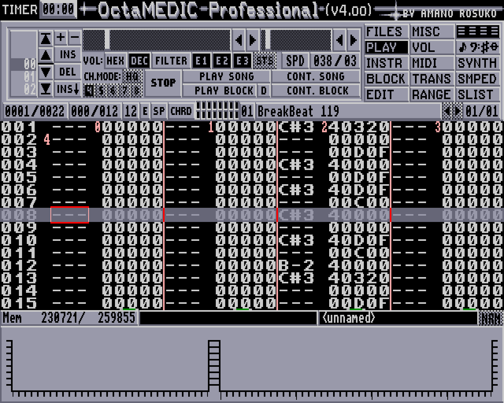

# OctaMEDIC Pro

A faithful, standalone clone of OctaMED Professional v4, the Amiga tracker, for Windows, Linux and
macOS. It's a program of its own, written from scratch: you don't need an Amiga, an emulator,
Kickstart ROMs or a copy of OctaMED to run it.



**v0.0.1 is the first demo.** Someone who knows OctaMED Pro v4 can sit down, make a short song
from samples start to finish, save it, and open it again later, here or in the real OctaMED.
Anything that isn't there yet is ghosted in the interface, just like OctaMED greys out what
can't be used.

## Features

### The OctaMED you know
- OctaMED Pro v4's screen, redrawn pixel for pixel: its panels, gadgets, fonts and 12-bit
  colour palette, and its keys
- Paula's four channels emulated, with the PAL or NTSC clock, so songs play at the speed and
  with the character they would on an Amiga

### Songs
- Loads MMD0 and MMD1 modules: notes, instruments and song settings
- Saves songs as MMD1 with their instruments, which the real OctaMED opens
- Play and continue song or block, with tempo, filter on/off and the volume command (0C), read as
  hex or decimal
- Clear song or clear all, and quitting asks first if there are unsaved changes

### Editing
- The block editor: notes, instruments, command digits, holds, highlights and octaves, inserting
  and deleting notes, spaces and tracks
- Ranges with cut, copy and paste, for tracks, blocks and selections
- The BLOCK panel: new blocks, lines, expand and shrink, split and join, and the rest
- The EDIT panel: track mutes, keypad maps, octaves, line spacing, SPACE=DEL and cursor advance
- The RANGE and TRANS panels: volume slides, chords, transposing, and changing or swapping notes
  and instruments
- Sequence editing: inserting and deleting entries and changing their blocks

### Instruments
- Loads WAV, MP3, FLAC, IFF and raw samples, converted to 8-bit mono the way an Amiga plays them
- The sample editor: ranges, zoom, cut, copy and paste, reverse, mix, freehand drawing, loops,
  pitch and rate changes, and playing a range
- Volume, transpose, finetune, hold and decay
- Saves instruments as raw, IFF or WAV

### Beyond the original
- Undo and redo in the block editor (Ctrl+Z, and Ctrl+Y or Ctrl+Shift+Z)
- Renders songs to WAV, from the GUI or the command line
- Picks the sound device and can mix to mono (VOL's OUTPUT)
- Switches between PAL and NTSC (Ctrl+F12)
- CRT style screen filters (Ctrl+F11): scanlines, chroma, VHS wobble, colour, curvature, vignette
  and noise, in any order and each with its own settings
- Remembers all of these between runs, in [config.toml](docs/CONFIG.md)

## Planned

Not in v0.0.1 yet, roughly in the order they'll come:

- The EDIT panel's programmable keys
- Sample commands besides volume, then MIDI and synth commands
- Playing synth and hybrid sounds (they're loaded and kept already)
- The rest of the RANGE panel: spread, the other slides and note echo
- More than four tracks, with split channels and MIDI
- Saving as MMD0, and MMD1 without instruments
- Loading ProTracker and SoundTracker modules
- MIDI in and out, with transport and clock sync, and routing tracks to audio interface outputs
- Machine memory as a setting, so the memory readout matches your Amiga
- Remappable keys and more settings
- Quality of life: moving entries in the sequence, configurable line highlights, an option to type
  instruments above 0V directly, and rendering to MP3

## Installation

Download the zip for your system from the [releases page](https://github.com/TheExiledCat/octamedic/releases).
Each release has two kinds of zip: `octamedic-gui-…` is the editor, and `octamedic-cli-…` is
`mmd_cli`, a command line tool for inspecting, playing and rendering modules. Most people only
need the GUI.

| System | Download |
|---|---|
| Windows (most PCs) | `octamedic-gui-<version>-x86_64-pc-windows-msvc.zip` |
| Windows on ARM | `octamedic-gui-<version>-aarch64-pc-windows-msvc.zip` |
| macOS, Apple Silicon (M1 and later) | `octamedic-gui-<version>-aarch64-apple-darwin.zip` |
| macOS, Intel | `octamedic-gui-<version>-x86_64-apple-darwin.zip` |
| Linux (most PCs) | `octamedic-gui-<version>-x86_64-unknown-linux-gnu.zip` |
| Linux on ARM | `octamedic-gui-<version>-aarch64-unknown-linux-gnu.zip` |

There's nothing to install: unzip it and run what's inside.

### Windows

1. Unzip it and double-click `octamedic_gui.exe`.
2. The app isn't signed, so Windows may say it protected your PC. Click **More info**, then
   **Run anyway**. You only need to do this once.

### macOS

1. Unzip it and move `OctaMEDIC.app` to your Applications folder.
2. Open it. The first time, macOS says it can't check it for malware, because it isn't notarized
   by Apple, and won't open it.
3. Go to **System Settings > Privacy & Security**, scroll down and click **Open Anyway**. Or run
   this once in Terminal instead:

   ```sh
   xattr -dr com.apple.quarantine /Applications/OctaMEDIC.app
   ```

The CLI needs the same the first time.

### Linux

1. Unzip it. You need ALSA's library, which almost every desktop already has (`libasound2` on
   Debian and Ubuntu, `alsa-lib` on Fedora and Arch).
2. Run it:

   ```sh
   chmod +x octamedic_gui   # if the zip didn't keep it executable
   ./octamedic_gui
   ```

### Opening a module

Pass a module to open it straight away, like `octamedic_gui song.mmd1`, or open one with LOAD
SONG on the FILES panel. On macOS, pass it to the app with `open`:

```sh
open -a OctaMEDIC --args ~/Music/song.mmd1
```

Give the module's whole path, since the app doesn't start in the folder you're in. If OctaMEDIC is
already open, `open` only brings it to the front, so quit it first. Double-clicking a module in
Finder doesn't open it yet.

## Using it

OctaMEDIC works like OctaMED Pro v4, so the original OctaMED manual is the manual. A short addendum
of what's different comes with each release's notes, along with the known issues.

A few keys that aren't in the original:

| Key | Does |
|---|---|
| Ctrl+F11 | Screen filters |
| Ctrl+F12 | Switch between PAL and NTSC |
| Ctrl+Z, Ctrl+Y | Undo and redo in the block editor |
| Ctrl+` | The debug console, with any startup errors |
| Ctrl+Q | Quit |

## Configuration

Settings are saved in `config.toml` as you change them in the app: the video standard, the sound
device, mono, and the screen filters. [docs/CONFIG.md](docs/CONFIG.md) says where it is and what
every setting does.

## Building from source

You need [Rust](https://rustup.rs) 1.85 or newer. On Linux you also need ALSA's development files
(`libasound2-dev` and `pkg-config` on Debian and Ubuntu).

```sh
git clone https://github.com/TheExiledCat/octamedic
cd octamedic
cargo run --release -p octamedic_gui
```

You get the newest changes this way, and also the ones that break things.
[CONTRIBUTING.md](CONTRIBUTING.md) has more.

## In this repo

- `mmd`: reads and writes OctaMED's MMD files
- `mmd_cli`: the command line tool, for inspecting, playing and rendering modules
- `octamedic_core`: the song model and the playback engine
- `octamedic_gui`: the editor
- `octamedic_util`: small helpers shared by the other crates
- `rustuition`: an Amiga style GUI toolkit recreating AmigaOS's Intuition look

## Contributing

- [CONTRIBUTING.md](CONTRIBUTING.md) for building, code style and pull requests
- [docs/CONFIG.md](docs/CONFIG.md) for `config.toml`
- [docs/PLAYER.md](docs/PLAYER.md) for how the player works (Paula, DMA, the CIA timer)
- [docs/FILES.md](docs/FILES.md) for the files besides modules: loading instruments, multi-octave
  samples, synth sounds and crash.log
- [rustuition/README.md](rustuition/README.md) for the GUI toolkit, and
  [octamedic_gui/FRAMEWORK.md](octamedic_gui/FRAMEWORK.md) for how the editor uses it
- [V0.0.1TARGETS.md](V0.0.1TARGETS.md) for what v0.0.1 set out to do

Found a bug, or something that doesn't behave like the real OctaMED? Open an issue with the
[bug report](.github/ISSUE_TEMPLATE/bug_report.md) template. Ideas go in a
[feature request](.github/ISSUE_TEMPLATE/feature_request.md).
